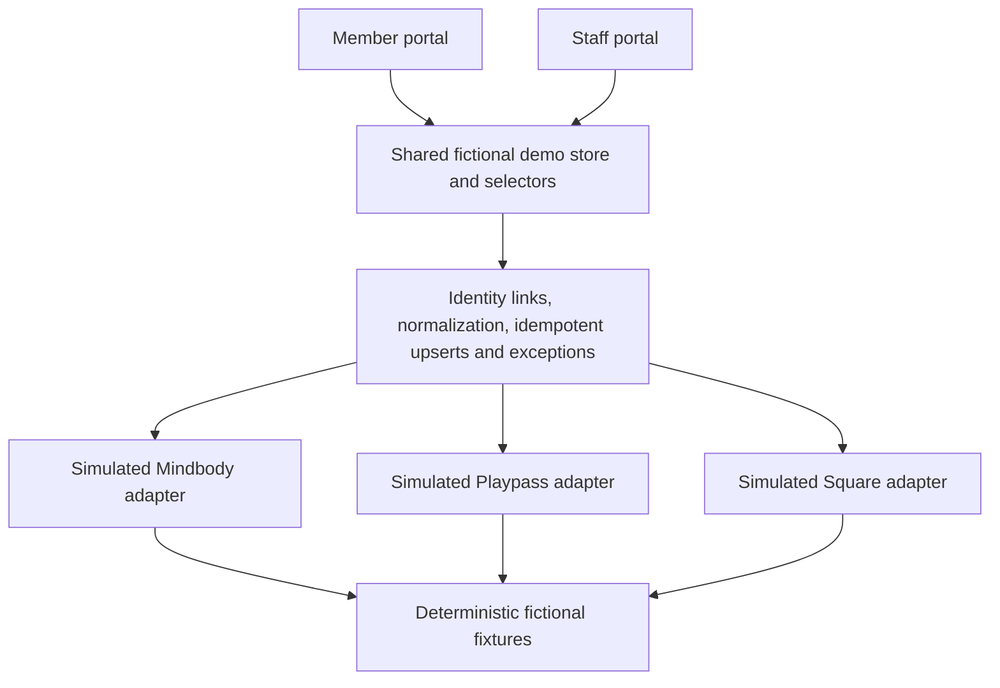

# Soccer City Connect — repository assessment and scoped build plan

Prepared November 13, 2026 against the November 12 master brief.

## Baseline and isolation

Repository: https://github.com/shawteone1/Soccer-Center

Inspected base: `main`, `11de067414e63c5d3e3e221dfc14cc026dfbd8d0` (Import Soccer Center source from GoDaddy).
Local checkout: `/workspace/soccer-city-connect`.
Local development branch: `codex/soccer-city-connect-poc`.

Only `main` was advertised by the cloned remote. GitHub returned no combined status entries or workflow runs for the base commit. This establishes the inspected source, not a validated production baseline. No AGENTS.md or dedicated engineering handoff instructions were found in the checkout. README is substantially template documentation; package.json and source are stronger implementation evidence.

This phase evaluates source and prepares the build plan. No functional prototype, test result, browser screenshot or provider verification is claimed. No application source was changed. No push, merge, deployment or publication is authorized. Arena-pathway- was not cloned or modified.

## Existing implementation and reuse

| Evidence | Reuse decision |
| --- | --- |
| package.json | React 19, TypeScript, Vite 6, Tailwind, Radix/shadcn primitives, React Router, Vitest and Playwright dependency; Node >=22.22.0. Keep this stack. |
| src/components/portal/PpPrimitives.tsx | Reuse cards, buttons, badges and fictional profile presentation with the existing pp-shell styles. |
| src/components/portal/CalendarViews.tsx; src/lib/portal/calendar-display.ts | Reuse month/week display and America/Denver formatting. Adapt normalized events into CalendarDisplayEvent; keep provider ownership visible in details and schedule list. |
| src/pages/demo/parent-portal.tsx; src/lib/demo/use-portal-demo.ts | Reuse fictional family selection and scoped persistence/reset patterns, without sharing existing demo storage keys or importing the entire recruiting experience. |
| src/layouts/Dashboard.tsx | Configurable sidebar/header suitable for staff navigation. Actual admin pages are content/settings screens, not an existing member-operations dashboard. |
| src/layouts/PortalLayout.tsx | Auth-aware layout calls real profile endpoints. Reuse visual/navigation concepts, avoid mounting it in the fictional POC. |
| src/server/pilot/types.ts; src/server/pilot/store.ts | Existing PlayMetrics pilot models connector mode, refresh status and source references. Reuse concepts only; preserve its store and APIs. No general Mindbody/Playpass/Square abstraction was found. |
| src/demo-main.tsx | Existing dedicated demo entry proves isolation within this repository is practical. Add a Soccer City-specific entry/config rather than a new application or production route. |

Current demo scripts reference absent `vite.demo.ts` and `e2e/coach-share-demo.spec.ts`. Do not claim they run. Implement a separately named Soccer City config and tests; do not repair unrelated demo features as part of this effort.

## Scoped implementation sequence

1. Establish baseline: install from package-lock under the required Node version; run existing type-check, non-watch tests and client/server build. Record pre-existing failures before changing source. Inspect build plugins and transitive demo imports for auth, analytics and database side effects.
2. Add `src/lib/soccer-city-connect/` for models, deterministic fixtures, identity links, three provider adapters, normalization, synchronization and a shared demo store. Add an isolated Vite HTML/React entry and config using existing styling/components; keep normal routes, database schemas, auth, server pilot and default build untouched.
3. Add member and admin pages under `src/pages/soccer-city-connect/`, mounted only by the new entry. Proposed local routes: `/soccer-city-connect/member` and `/soccer-city-connect/admin`. Role switching is visibly a demonstration control, not authentication or authorization.
4. Implement the six-scenario walkthrough: fictional active membership; simulated league registration; camp enrollment supported by a separate simulated Square transaction status and enrollment association; outstanding waiver; staff simulated source review/resolution; shared operations schedule and commitments. Include reset and scenario controls.
5. Implement sync failure/staleness and ambiguous identity scenarios, activity history and source details. Add focused unit/component tests and Playwright journeys, then repeat the established regression checks.
6. Deliver screenshots of both portals, integration map, demonstration instructions, pilot proposal and ROI worksheet. Commit the completed prototype locally to this development branch; report SHA, full changed-file list, exact commands/results and remaining limitations. Do not push or use the GitHub-to-Codespaces handoff until separately authorized.

## Integration contract and map

Every record retains provider, fictional provider account, record type, source record ID, source update time, import time, raw status and normalized status. Namespace upsert keys by provider/account/type/source ID. Preserve cancelled records and use source occurrence IDs for event deduplication. Do not deduplicate distinct provider records solely because title/time match; use explicit confirmed links when two records describe one activity.

Family membership and participant links are explicit fixture relationships. Provider identities remain separate; candidate matches based on names/emails never become automatic merges. Include a second fictional household and a same-name record to prove separation. Unresolved identity links cannot grant visibility or eligibility.

Use one reactive store for both views, persisted only under a new `sc_city_connect_demo_v1` namespace. Synchronize same-browser tabs via storage events. Reset touches this namespace only. No real member APIs, credentials, analytics, payment UI or document uploads. Browser persistence is a fictional demonstration convenience, not production audit storage.

Adapters are simulated and read-only by default. A separately named simulation operation changes fictional source fixtures and then runs normalization, recording actor, action, source, before/after values, timestamp and simulation mode. Repeated resolution is idempotent. Label the result “Simulated resolution — no provider updated.” Never change a payment status as a proxy for collecting money.

Track last attempted sync, last successful sync, error and stale threshold per provider. On failure, keep last-known data with an explicit warning; do not silently show it as fresh. Anchor deterministic scenarios to a visible demo clock. Record event start/end with timezone-aware instants and show schedules in America/Denver. Detect participant and field overlaps when fixture information supports them.

## Provider systems map and discovery constraints

The meeting observations and website relationships below come from the supplied brief, not an independent technical verification performed in this assessment.

| Provider | Proposed authoritative ownership | Future access investigation |
| --- | --- | --- |
| Mindbody (first priority) | Membership, client, booking and purchase records for functions actually used | Verify current official API documentation, developer approval, business authorization, scopes, availability, fees and source status semantics. |
| Playpass | Organizer league registration, teams and schedules where confirmed | Verify documented API/export availability, organizer permissions and stable participant/event identifiers. Do not promise API access. |
| Square | Customer/order/payment transaction status where configured | Verify official supported APIs, account authorization, scopes, sandbox and webhook verification. A paid order alone does not prove participation eligibility or camp enrollment. |
| Other tools | Unknown pending discovery | Confirm actual waiver, rental, check-in, attendance and communications workflows before assigning ownership. |

POC source links open an internal simulated source record viewer with the fictional ID. Do not fabricate live provider URLs. Approved registration/booking links and real provider deep links require configuration verification. No cross-provider SSO assumption. Independently verify current official provider capabilities before any live implementation commitment.

## Validation and acceptance

- Unit tests: explicit identity associations; same-name/email ambiguity; cross-household separation; provider-scoped keys; repeated refresh/resolution without duplication; correct membership/registration normalization; source ownership; failed refresh retention; stale thresholds; timezone and conflict handling.
- Component tests: family and program associations, source badges, visible simulation labels, empty/error states, exception prioritization, audit history and matching member/admin selectors.
- Browser tests: all six scenarios; admin resolution followed by member update, including two tabs; refresh/reset behavior; failed/stale connector controls; calendar navigation; narrow/mobile layouts; keyboard navigation and accessible action labels.
- Network assertions: fictional demo makes no provider, member, auth, payment or production API requests. Inspect bundle boundaries for unexpected production imports.
- Regression: compare pre/post type-check, existing Vitest suite and default client/server build; smoke-test existing routes where the local runtime permits. Report exact blockers and pre-existing failures. A visual review alone cannot establish no regression.
- Capture member/admin screenshots after the workflow, and provide reproducible run commands in the handoff. No browser tests or screenshots have been produced during this planning phase.

## ROI framework

Collect actual annual workflow volumes and observed before/after minutes per task. Segment membership, registration, exception resolution and schedule changes to avoid double counting. Measure systems opened, repeated entry steps, support inquiries and member completion time alongside labor.

Gross annual labor value = sum(volume × minutes saved / 60 × loaded hourly rate).
Annual net economic benefit = gross labor value + evidenced cash savings − annual integration, licensing, maintenance and exception-handling costs.
First-year net benefit also subtracts implementation/training cost.
First-year ROI = (first-year benefits − first-year costs) / first-year costs, when costs are positive.

Separate capacity released from actual cash savings. Do not populate business-volume assumptions or claim measured savings. Use measured pilot ranges and document uncertainty.

## Pilot proposal and outstanding requirements

Stage 1 is fictional only. Stage 2 would be a separately scoped authorized read-only pilot, starting with Mindbody. Before it begins, confirm the twelve discovery questions in the master brief; actual provider workflows and contracts; account ownership and scopes; lawful data access and retention; identity confirmation procedures; staff/member authorization boundaries; revocation and error handling; approved source links; and measured baseline metrics.

Agree pilot participants, duration and numeric success thresholds with Soccer City after baseline collection. Evaluate association accuracy, duplicate rate, sync freshness, exception resolution time, systems accessed per task, member task completion and total integration cost. Missing authorization, unresolved ownership or failed identity controls blocks live connection. No data migration, live write-back or provider replacement is in this POC. LockedIn remains optional and out of initial scope.

Use the dedicated Soccer City Connect conversation for subsequent decisions and the first actual build/validation report. Creating or moving a chat is outside the repository workflow and has not been performed here.
