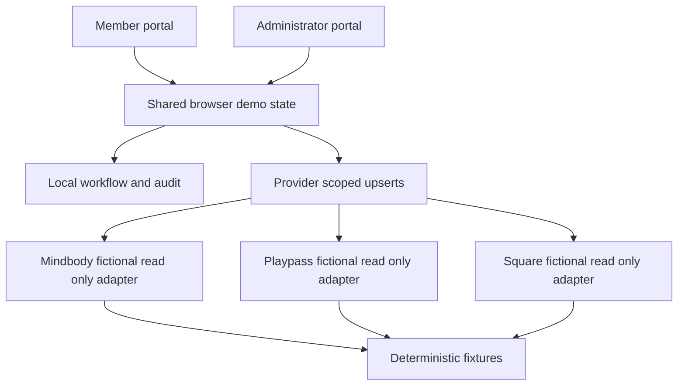

# Soccer City Connect — functional demonstration

Powered by Soccer Center. A local member/admin proof of concept with fictional Mindbody, Playpass and Square records. Existing providers remain authoritative. This is not an approved pilot or a membership/payment replacement.

## Start locally

```bash
cd /workspace/soccer-city-connect
# Only if dependencies are missing; inherited npm ci currently fails:
npm install --ignore-scripts --package-lock=false --no-audit --no-fund
cd soccer-city-connect
npm run dev
```

Use Node >=22.22.0. Open **http://127.0.0.1:5187/#member** or **http://127.0.0.1:5187/#admin**. The view switch is a demo control, not authentication. Stop with Ctrl-C. In Codespaces, forward this port privately for review; nothing has been pushed or deployed.

The isolated package uses installed parent dependencies. No production manifest/lockfile was changed. The inherited lockfile lacks yjs/lib0/isomorphic.js entries; the install above leaves it untouched and resolves existing dependency ranges. This is not a claim of reproducible locked installation. Validation used Node 24.22.1, Vite 6.4.6 and Playwright Chromium build 1254.

## Guided walkthrough

1. Open Member portal and **Reset demo**. Meet parent Jordan Rivera and participant Alex Rivera. An unrelated same-name participant belongs to household `chen`; names are never auto-merged.
2. Inspect active Mindbody membership `MB-M-100`, renewing December 13, 2026. **View simulated source** shows provider, account, type, ID, raw/normalized status and source/import timestamps.
3. Review Playpass enrollment `PP-R-200`, then Square transaction `SQ-T-300` with status `COMPLETED`. No card data or payment processing exists. Camp association is a separate explicit fixture `SQ-EN-301`; transaction completion alone never establishes eligibility.
4. Inspect the combined November calendar and provider filter: November 14 league, November 15 pickup, November 21 camp. Times use America/Denver. The agenda lists all provider/search-filtered commitments; month navigation applies to the calendar grid.
5. The participation waiver `MB-W-102` has provider status **Missing**, local workflow **Open**. Switch to Administrator. Search by member, program or source ID; clear search for all operations.
6. Review its source, then **Resolve local workflow (simulated)**. History records actor, time, source, before/after and simulation mode. **Provider status remains Missing.** This does not upload a waiver, confirm eligibility or update Mindbody.
7. Switch back and refresh: local resolution persists. A second same-origin browser tab also updates through storage events.
8. In Administrator, repeatedly **Sync Mindbody**: no duplicates, local resolution remains. **Simulate Playpass failure**, then **Retry Playpass** demonstrates recovery. **Retry … with failure** demonstrates exhaustion at three attempts. **Sync …** deliberately starts a new cycle. No automatic retries or external requests occur.
9. **Mark … stale** displays last-known-data warnings in both views. A successful simulated sync clears that warning. Staleness is an explicit scenario, not a production SLA.
10. Registration/booking buttons show simulated notices; they submit nothing. **Reset demo** resets only `sc_city_connect_demo_v1`, including resolutions, health and history, preserving unrelated storage.

## Integration map and ownership



| Source | Authoritative records in this demonstration | IDs |
| --- | --- | --- |
| Mindbody | Membership, booking, missing waiver; unlinked identity | MB-M-100, MB-B-101, MB-W-102, MB-M-999 |
| Playpass | League enrollment and session | PP-R-200, PP-E-201 |
| Square | Transaction status; separate camp enrollment/schedule fixtures | SQ-T-300, SQ-EN-301, SQ-E-302 |
| Local demonstration | Family links, local workflow, health, audit | parent/athlete → rivera; other → chen |

These assignments describe fictional fixtures, not verified Soccer City configuration. In particular, Square camp scheduling and Mindbody waiver ownership need discovery.

Normalized fields: `provider`, `account`, `kind`, `sourceId`, `personId` (explicit fixture link or null), `title`, `rawStatus`, `status`, `sourceUpdatedAt`, `importedAt`; events add `startAt`, `endAt`, `location`; membership adds `renewal`. Upsert key: **provider + account + type + source ID**. Source occurrence IDs prevent duplicated events. No fuzzy identity matching, inferred eligibility or cross-provider event merge occurs.

Three separate adapters expose provider, simulation mode, read-only access, maximum attempts and read behavior. There is no credential, external URL, OAuth implementation or write method. Future approved authentication belongs behind a server boundary, never in browser secrets. API/authentication support remains unverified.

Source records and local resolutions are separate. Refreshes preserve local workflow reviews. Failed sync retains records and last-success time, records attempt/error and audits it. Three manual attempts bound each retry cycle. Future integrations need async transport, source schema validation, pagination/cursors, timeouts, rate limits, provider-directed backoff, durable idempotency/audit and revocation. No live authentication mechanism is presumed.

Initial fixtures use a fixed clock; actions use real timestamps. Schedule overlap review compares participant/field intervals, without changing bookings. The initial schedule has no conflicts.

## Isolation, persistence and reuse

All additions live in this directory. Normal routes, database, server, credentials, default npm scripts and deployment config are unchanged. The prototype imports Soccer Center's existing `MonthView`, calendar stylesheet and date/time helpers. Avatars, family cards, navigation and blue/white/grey styling follow portal patterns without mounting real auth/profile APIs.

A separate Vite/HTML entry avoids missing legacy demo scripts. A restrictive CSP, local fonts, no analytics and no provider network code keep it local. Browser validation observes no external host or `/api/` requests during the full walkthrough. `.browser.ts` filenames keep Playwright tests out of parent Vitest discovery.

State is same-origin browser localStorage. Refresh and sequential same-browser tabs work; simultaneous writes have no arbitration, different devices do not share data, and audit history is not tamper-resistant. There is no production authentication or authorization. Storage denial displays a warning; invalid JSON falls back to fixtures. Do not enter real information. Production persistence/access controls require separate implementation.

## Validation and screenshots

From this directory:

```bash
npm run type-check
npm test
npm run build
# Official one-time browser installation, if missing:
PLAYWRIGHT_BROWSERS_PATH=/tmp/scc-browsers npx playwright install chromium
PLAYWRIGHT_BROWSERS_PATH=/tmp/scc-browsers npm run test:browser
```

Playwright starts/stops the isolated server. Managed sandbox validation needed permission to bind localhost and launch Chromium. See [VALIDATION.md](VALIDATION.md) for actual results and inherited failures.

- [Member desktop](artifacts/member-desktop.png) · [Administrator desktop](artifacts/admin-desktop.png)
- [Member mobile](artifacts/member-mobile.png) · [Administrator mobile](artifacts/admin-mobile.png)

Desktop screenshots show completed local resolution; mobile screenshots show initial state. Tests cover the full workflow, cross-tab/refresh persistence, search/calendar filters, source references, idempotency, retry bounds, stale warnings, audit, reset, mobile layout, keyboard inspection, timezone and identity separation.

## Live pilot requirements and limitations

No real provider connection or pilot is approved. Meeting facts/provider relationships come from the November 12 brief. Current provider capabilities, contracts, permissions and actual Soccer City configuration have not been independently verified in this build.

Start with Mindbody: confirm actual membership/client/booking/waiver use, three main frustrations, simplification versus replacement goals, account ownership, official access methods, developer/business approval, scopes and fees. For Playpass verify organizer-owned API/export availability and authorized registration/team/schedule access. For Square verify official account authorization, customer/order/status capabilities, sandbox/webhook verification and actual camp enrollment mapping. Do not assume API access, OAuth, SSO or deep links are available.

Before live data, secure Soccer City/provider authorization; establish ownership, family identity confirmation, staff/member access rules, minimum fields, retention/deletion, revocation and approved provider destinations. Implement read-only server connectors and durable monitoring, recovery/audit. Confirm actual rentals, waivers, check-in, attendance and communications systems. Agree cohort, duration, measured baseline and numeric pilot thresholds. No migration or provider replacement is needed. Write-back and LockedIn remain later, separately authorized work.

## ROI framework — proposed measurements, no measured savings

Measure actual annual task volumes, loaded hourly rate and before/after minutes for lookup, registration, waiver follow-up, reconciliation, schedule change and member support; avoid double counting. Track systems opened, repeated entry, mismatch/exception counts, member completion time and integration operating costs.

- Gross labor capacity value = sum(annual volume × minutes saved / 60 × loaded hourly rate).
- First-year costs = implementation + training + provider/licensing + hosting + maintenance + exception handling.
- First-year net value = gross labor capacity value + evidenced cash savings − first-year costs.
- ROI = (first-year benefits − first-year costs) / first-year costs, where costs > 0.

Capacity released is distinct from actual cash savings. No business volumes or savings have been invented, and no pilot outcomes have been measured. Agree thresholds after baseline collection; track identity accuracy, duplicates, freshness, resolution time and member completion alongside cost.

Continue decisions in the dedicated Soccer City Connect thread. Repository tools have not created/moved a chat. Stop before push, merge, deployment or publication.
